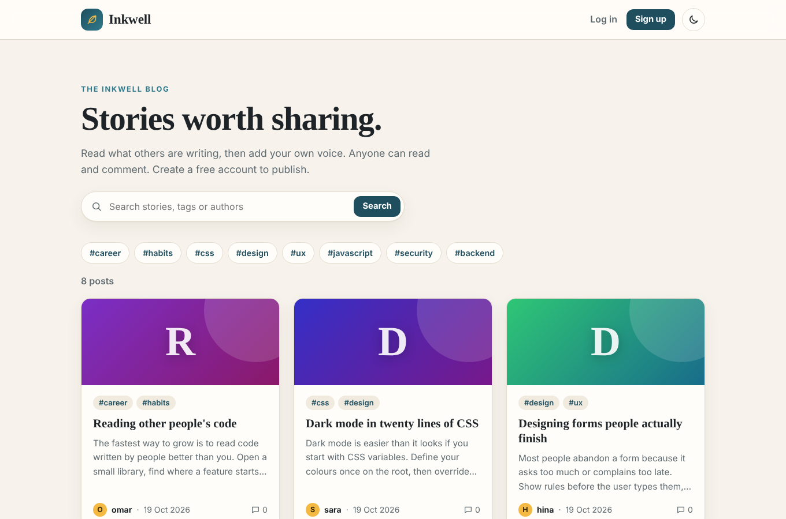
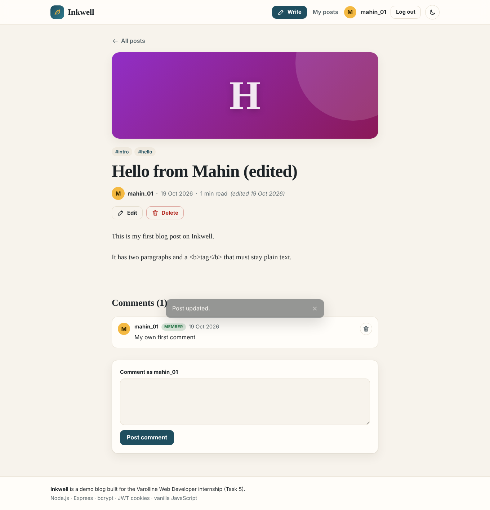
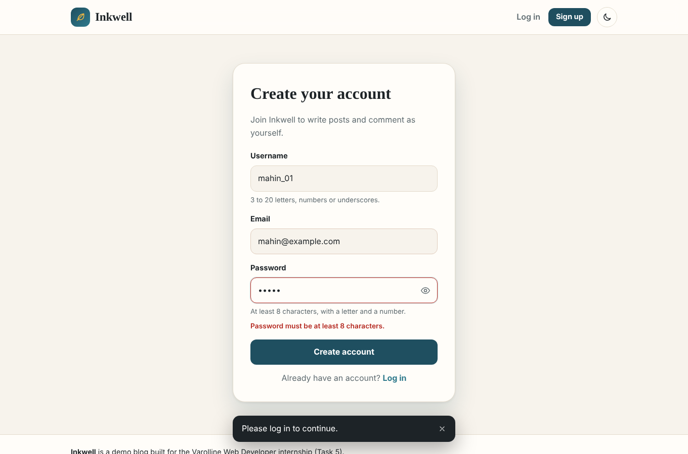
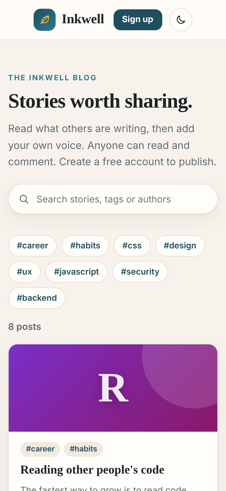

# Inkwell: Blog Platform with Authentication

A blog where people can **sign up, log in and log out**, **create, edit and delete their own posts**, and where **anyone can read posts and comment**.
Built for the Varolline Web Developer internship (Task 5) with **Node.js + Express**, **bcrypt**, **JWT in secure cookies** and a plain **HTML, CSS and JavaScript** front end.

**Author:** Mahin Saleem  
**Repository:** https://github.com/mahinsaleem001-debug/Web_Developer_Varolline_Task5



## Requirements checklist

| Requirement | How it is delivered |
|---|---|
| Sign up, log in, log out | `POST /api/auth/signup`, `/login`, `/logout` with forms in the UI |
| Create, edit, delete **own** posts | Owner-only API (`403` for anyone else) and Edit/Delete buttons shown only to the owner |
| Anyone can read and comment | Public `GET` routes. Visitors comment with a name, members comment as themselves |
| Hash passwords | `bcryptjs` (cost 10). Only the hash is stored |
| Protect routes | JWT in an `HttpOnly`, `SameSite=Strict` cookie. Server checks login on every protected route. The browser also redirects visitors away from `#/write` and `#/edit` |
| Validate on client and server | One shared rules file, `public/js/validate.js`, used by the browser for instant messages and by the server to re-check everything |
| Database | A document database stored in one JSON file (`data/blog.json`), wrapped in `server/db.js` (see below) |
| API / route documentation | [`docs/API.md`](docs/API.md) |

### Extras
Search, tags and author filters, pagination, light/dark theme, post covers generated from the title, comment deletion (by the comment author or the post owner), login rate limiting, CSRF guard, security headers (CSP), accessible forms, demo seed data, 22 automated tests.

## Screenshots

| Reading a post | Sign up with validation | Mobile |
|---|---|---|
|  |  |  |

## Run it

Needs **Node.js 18 or newer**.

```bash
npm install
npm run seed     # optional: adds demo posts and users
npm start        # http://localhost:3000
```

Demo logins after seeding (password for all: `Demo1234`): `sara@example.com`, `omar@example.com`, `hina@example.com`.
Or just create your own account on the Sign up page.

Run the tests (the server is started automatically on a random port):

```bash
npm test
```

### Settings (optional environment variables)
See `.env.example`. `JWT_SECRET` should be a long random string. If it is missing the server makes a random one, which logs everybody out whenever it restarts. `PORT` changes the port, `DB_FILE` changes where data is stored.

## Project structure

```
server/index.js        Starts the server
server/app.js          Express app: security headers, auth, routes, validation, errors
server/db.js           Database layer (JSON file, atomic saves)
public/index.html      Page shell
public/css/style.css   Theme, layout, components
public/js/validate.js  Validation rules shared by browser and server
public/js/api.js       Fetch wrapper (CSRF header, error handling)
public/js/app.js       Interface: router, pages, forms, comments
scripts/seed.js        Demo data
tests/                 22 tests (validation + API)
docs/API.md            API and route documentation
```

## How it works (short version)

- **Passwords.** On sign-up the password is hashed with bcrypt (a slow, salted hash). On login the typed password is compared with the hash. When the email does not exist the server still runs a dummy comparison, so response time does not reveal which emails are registered, and the error message is the same for both cases.
- **Sessions.** After login the server signs a JWT containing only the user id and puts it in an `HttpOnly` cookie, so page scripts cannot steal it. Each request loads the user from the database, so a deleted account stops working at once.
- **Protected routes.** `requireAuth` blocks visitors with `401`. Edit and delete also compare `post.authorId` with the logged-in user and answer `403` otherwise. Ownership is never decided in the browser.
- **Validation twice.** `validate.js` returns cleaned values and a message per field. The browser shows messages on blur and on submit. The server runs the same function on every request, so a hand-made request cannot skip it. Wrong types, huge bodies and invalid JSON are rejected too.
- **Other protection.** CSRF header check plus `SameSite=Strict`, login rate limiting, a Content-Security-Policy that blocks inline scripts, `textContent`-only rendering (no `innerHTML`), a 30 KB body limit, and no password hash or email ever sent in post or comment responses.
- **Database.** `server/db.js` keeps three collections (users, posts, comments) in a JSON file and writes it atomically (temp file, then rename). It is simple on purpose, so the project runs anywhere with `npm install` and nothing else to set up. Because routes only call the functions in `db.js`, it can be replaced with SQLite, PostgreSQL or MongoDB by rewriting that one file.

### Known limits
- The JSON database suits a demo or a small blog, not many users writing at the same moment.
- JWT logout clears the cookie in the browser. A copied token would stay valid until it expires (2 days).
- Rate limiting is kept in memory and resets when the server restarts.

## Tech

Node.js · Express 4 · bcryptjs · jsonwebtoken · HTML5 · CSS3 · Vanilla JavaScript · Node's built-in test runner

## AI tool usage

This project was built with assistance from an AI tool (Claude). All code was reviewed, run and tested by me, and I can explain how each part works.
